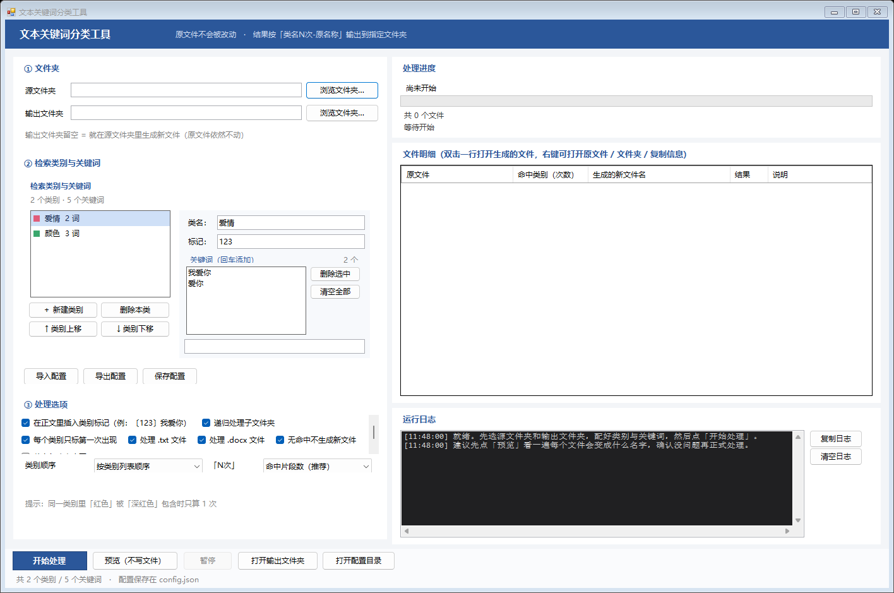
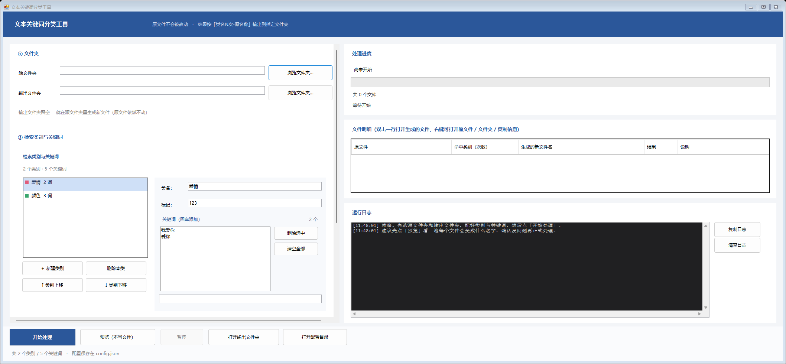
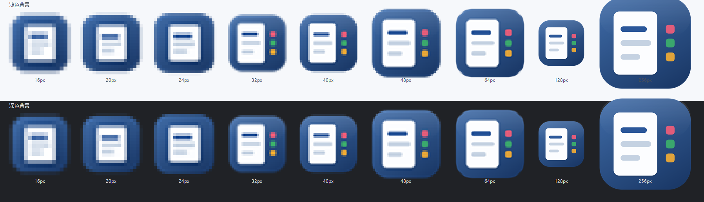

# 文本关键词分类工具 (KeywordClassifier)

按类别检索文件夹里的 **.txt / .docx**，统计每个类别命中多少次，在关键词前插入类别标记，
再按「**类名N次-原名称**」重命名输出到指定文件夹。**原文件永远不会被修改。**

[](https://github.com/fewoot/text-keyword-classifier/actions/workflows/build.yml)




---

## 功能

- **按类别检索**：一个类别下可以放多个关键词，命中任意一个都算该类别命中
- **同类别最长优先**：同一类别里「红色」被「深红色」包含时只算 1 次，不重复计数
- **跨类别独立计数**：同一段文字被两个类别各自命中时，两边各算 1 次
- **三种计数口径**：命中片段数 / 关键词出现次数 / 命中的不同关键词个数，界面可切换
- **插入类别标记**：正文里写成 `〔123〕关键词`，可选「每类只标第一次」
- **输出重命名**：`爱情2次-颜色3次-原名称.txt`，类别顺序可配置，重名自动加 `(1)`
- **原文件不动**：结果一律写到输出文件夹，子目录结构原样保留
- **编码自动识别**：UTF-8（带/不带 BOM）、UTF-16、GBK；输出统一带 BOM 的 UTF-8
- **.docx 直接解析**：读取 OOXML 里的正文，**不需要安装 Word**
- **预览模式**：先跑一遍看每个文件会变成什么名字，不落盘
- **界面友好**：文件夹选择、类别/关键词编辑、实时进度、文件明细表（双击打开）、带时间戳日志、暂停/继续
- **高 DPI 适配**：所有尺寸与字体按显示器缩放比例放大，125%/150% 下文字不会被截断
- **零第三方依赖**：单个 exe，不装运行时、不装解释器、不联网

<details>
<summary>150% 显示缩放下的界面（高 DPI 适配）</summary>



</details>

---

## 快速开始

### 方式一：直接运行（推荐）

1. 到 [Releases](../../releases) 下载 `KeywordClassifier.exe`
2. 双击运行（Windows 10/11 自带 .NET Framework 4.8，无需安装任何东西）

### 方式二：自己编译

只需要 Windows 自带的 .NET Framework 编译器即可，**不要求安装 Visual Studio**：

```bat
build.bat
```

生成 `bin\KeywordClassifier.exe`。可选参数：

| 命令 | 作用 |
|---|---|
| `build.bat` | 只编译 |
| `build.bat selftest` | 编译并运行 43 项核心算法自检 |
| `build.bat run` | 编译并启动程序 |
| `build.bat q ...` | 同上，但结束时不等待按键（CI 用） |
| `test-all.bat` | 跑全部 167 项自动化测试 |

> 编译脚本会自动寻找编译器：`WCT_CSC` 环境变量 → PATH 里的 `csc.exe` →
> 任意版本的 Visual Studio（2017–2022，自动扫描）→ .NET Framework 自带的 `csc.exe`（C# 5）。
> 源码刻意只用 C# 5 语法，所以最后一种兜底方式也能编译。

---

## 使用说明

1. **源文件夹**：要处理的文档所在目录（点「浏览文件夹…」选择）
2. **输出文件夹**：结果存放位置（留空 = 就在源文件夹里生成新文件）
3. **新建类别**：点「＋ 新建类别」，在右边改**类名**和**插入标记**
4. **加关键词**：在输入框里打字，回车添加；双击关键词可删除
5. 点 **「预览（不写文件）」** 确认文件名，再点 **「开始处理」**

设置会自动保存到 exe 旁边的 `config.json`，下次启动自动恢复；类别配置支持导入/导出 JSON。

### 处理选项

| 选项 | 说明 |
|---|---|
| 在正文里插入类别标记 | 命中处写成 `〔123〕关键词` |
| 每个类别只标第一次出现 | 取消勾选 = 每次出现都标 |
| 递归处理子文件夹 | 输出保持同样的目录结构 |
| 处理 .txt / .docx | 可分别勾选 |
| 无命中不生成新文件 | 一个类别都没命中的文件直接跳过 |
| 英文关键词忽略大小写 | 默认区分大小写 |
| 文件名类别顺序 | 按类别列表 / 按命中次数 / 按文中首次出现 |
| 「N次」怎么算 | 见下节 |

---

## 计数规则

### 同一类别内：最长优先，被包含的词不重复计数

颜色类里同时有 `红色` 和 `深红色`，文中出现「深红色」→ **只算 1 次**（算「深红色」），
不会再多算一次「红色」。实现方式是「从左到右、最长优先、命中后跳过该片段」。

### 跨类别：互不影响

`深红色` 同时在 A 类（含 `深红色`）和 B 类（含 `红色`）命中时，**A、B 各算 1 次**；
正文标记只插一次，写成 `〔A标记、B标记〕深红色`。

### 「N次」的三种口径

以「颜色类含 `红色`/`深红色`，文中『深红色，还有红色』」为例：

| 口径 | 结果 |
|---|---|
| 命中片段数（默认） | **2** |
| 关键词出现次数 | **3**（深红色 1 + 红色 2） |
| 命中的不同关键词个数 | **2** |

---

## 测试

```bat
test-all.bat
```

| 测试套件 | 项数 | 覆盖内容 |
|---|---|---|
| `SelfTest`（`--selftest`） | 43 | 匹配算法：最长优先、跨类别、连续重复、大小写、空白、跨段落、三种口径、标记插入、特殊字符、空输入 |
| `E2ETest` | 23 | 真建 txt/docx 跑处理：编码识别、docx 解析、子目录递归、重名 `(1)`、无命中跳过、`.doc` 报错、原文件未被修改、预览不写文件 |
| `UiSmoke` | 14 | 不显示窗口构造主窗体，检查控件树、默认类别、下拉框选项 |
| `ConfigTest` | 32 | 临时副本里真启动一次：配置写入/逐字段恢复/界面还原/配置损坏时回退 |
| `LayoutTest` | 40 | 5 种窗口尺寸下检查控件重叠、被压扁、按钮变形、标签截断 |
| `DpiTest` | 15 | 100%/125%/150% 三种缩放下检查文字截断、列表高度、重叠，并输出截图 |

`--selftest` 在 cmd 控制台可能显示成乱码（GUI 子系统仍按 GBK 输出），
看最后的 **exit code = 0** 即为全部通过。

---

## 项目结构

```
.
├─ build.bat                    一键编译（自动找编译器，零依赖）
├─ build-vs.bat                 备选：用 MSBuild 编译
├─ test-all.bat                 跑全部 167 项测试
├─ KeywordClassifier.sln/.csproj
├─ assets/
│  ├─ app.ico                   程序图标（由代码生成，9 个尺寸）
│  └─ icon-preview.png          图标对照图
├─ docs/
│  ├─ notes.md                  ★开发笔记：25 个踩过的坑
│  ├─ customize.md              ★把这个项目改造成你自己的工具
│  └─ screenshots/              界面截图
├─ src/
│  ├─ Program.cs                入口、命令行参数、DPI 声明
│  ├─ Ui.cs                     ★尺寸/字体统一按 DPI 缩放
│  ├─ MainForm.cs               主窗体：三栏自动布局、进度、明细、日志
│  ├─ CategoryEditor.cs         类别与关键词编辑器
│  ├─ Keywords.cs               数据模型
│  ├─ Matcher.cs                ★匹配核心：区间收集 + 最长优先 + 跨类别合并
│  ├─ Processor.cs              ★流程：遍历、统计、写文件、重命名、异常分类
│  ├─ TextReaders.cs            编码嗅探 + docx 正文提取
│  ├─ Settings.cs               JSON 配置持久化
│  └─ SelfTest.cs               43 项核心算法自检
└─ tools/                       测试与诊断工具（不参与主程序编译）
   ├─ E2ETest.cs   UiSmoke.cs   ConfigTest.cs
   ├─ LayoutTest.cs   DpiTest.cs
   ├─ Probe.cs   Shot.cs         诊断：量控件坐标 / 渲染截图
   ├─ IconMaker.cs   IconPreview.cs
   └─ VerifyExeIcon.cs   VerifyWindowIcon.cs
```

---

## 支持的格式

| 类型 | 说明 |
|---|---|
| `.txt` | UTF-8（带/不带 BOM）、UTF-16、GBK 自动识别；输出统一为带 BOM 的 UTF-8 |
| `.docx` | 直接解析压缩包读正文；输出 = 原 Word 副本 + 同名带标记的 `.txt` |
| `.doc` | 老版二进制格式不支持，会提示「请先另存为 .docx」 |
| 其他 | 忽略（.pdf、.xlsx 等） |

---

## 已知限制

- 不支持 `.doc`（97–2003），请先另存为 `.docx`
- `.docx` 的标记版是另存的 `.txt`，不会改动 Word 文件本身
- 关键词不跨段落匹配（同一段落内才能命中）
- 仅支持 Windows

---

## 图标

图标不是图片素材，而是由 `tools/IconMaker.cs` **用代码画出来**的：9 个尺寸，
小尺寸自动简化，手写 ICO 容器后由编译器嵌入 exe（零第三方依赖）。
`tools/IconPreview.cs` 生成下面这张对照图，`tools/VerifyWindowIcon.cs` 会真正启动程序验证窗口图标。



---

## 文档

- [开发笔记：25 个踩过的坑](docs/notes.md)
- [把这个项目改造成你自己的工具](docs/customize.md)
- [更新日志](CHANGELOG.md)

---

## License

[MIT](LICENSE)

---

## English summary

A small Windows desktop tool to classify text files by keyword categories.
It scans a folder for `.txt` / `.docx` files, counts how many times each
user-defined category is matched, inserts category markers into the text
(`〔123〕keyword`), and writes renamed copies such as
`Love2次-Colors3次-original.txt` to an output folder. Original files are never
modified. Longest-match-wins inside a category prevents double counting of
nested keywords; different categories count independently.

Built with C# / WinForms on .NET Framework 4.8, no third-party dependencies.
Build with `build.bat` using the compiler shipped with Windows (C# 5 compatible
sources); run `test-all.bat` for 167 automated checks, including layout and
high-DPI regression tests.
